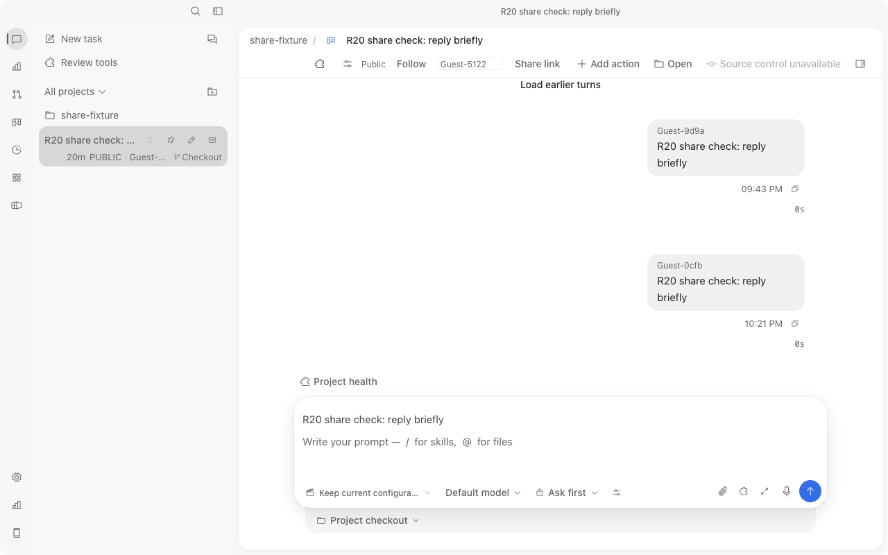
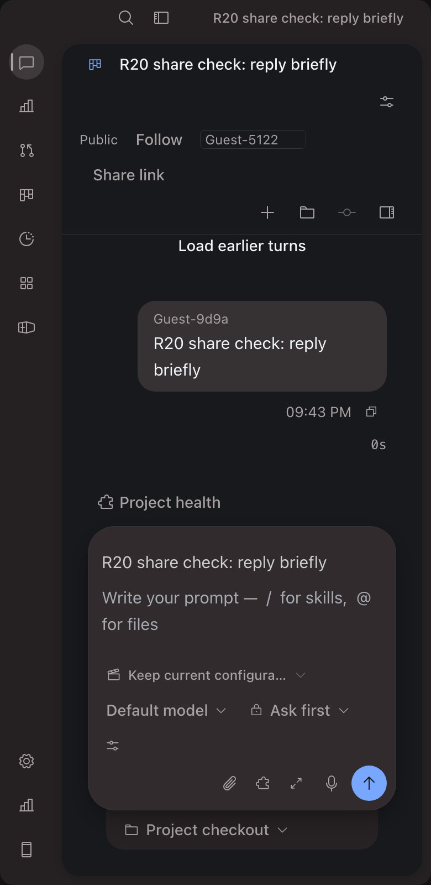
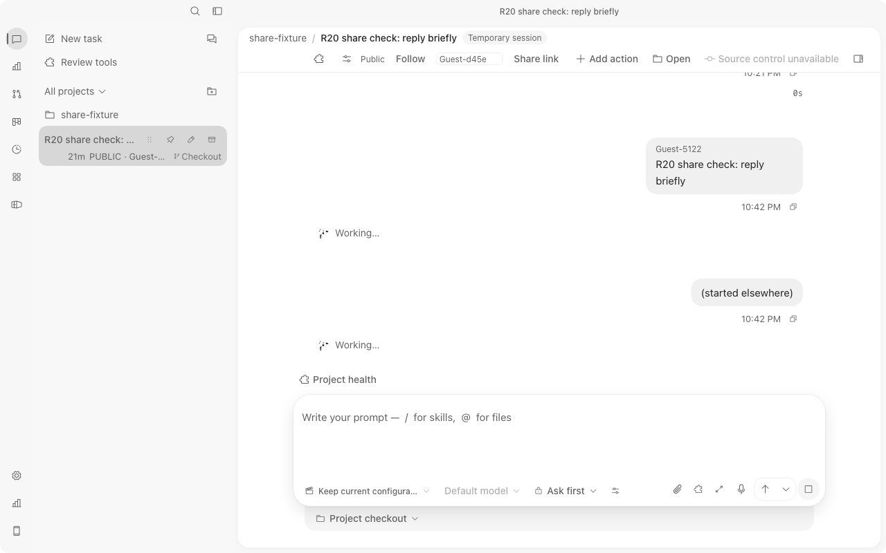

# R23 evidence manifest (PARTIAL)

Bounded slice: responsive session-header repair plus one foreign active/stop/continue pass on the zero-fee ACP fixture.

- Source: `apps/desktop/src/styles.css` (`.session-header.window-titlebar` and `.session-header .session-header-toolbar` now wrap) with the contract test in `apps/desktop/tests/windowChromeContract.test.ts`. `turns.ts` is unchanged, SHA 5e4677d0....
- Bundle: `vite build --mode web` exit 0. The header PNGs came from entry JS `percentages-BXMCSKIN-tlmE0bvs.js`; the final dist holds `...Cx6gAEV4.js` (sha256 8946bf12...) because of a reverted `turns.ts` experiment. The CSS is the same file in both builds: `percentages-BXMCSKIN-CMwT83sK.css` (sha256 4fa60071...).
- Measured (DPR 2, own default-profile tab): 1280x800 light has the header at 72px (two rows) and 0 controls clipped. 390x800 dark has `scrollWidth` 390, the header at 172px, and Follow, nickname, Share link, Session actions and View all inside the viewport.

- Live foreign turn: A pressed Run, and C (incognito, `localhost` origin) saw Stop and Queue plus a Working row. It also saw a duplicate `(started elsewhere)` row with its own Working row beside the canonical Guest-5122 prompt. C Stop ended A's turn with no stale Working row. C then submitted a new prompt, and A saw the canonical author Guest-d45e.

- Unresolved defect: the duplicate `(started elsewhere)` and Working row on a foreign running turn. A turns.ts attempt did not remove it, so it was reverted. Root cause is still unknown (suspects: `transcript_seq` mismatch or reconcile ordering).
- Also seen: C shows a "Temporary session" chip on a PUBLIC task.
- Not done: light 390, 480 and dark 1280 renders; console readout (consoleEntries were empty in snapshots); the private-task header.
