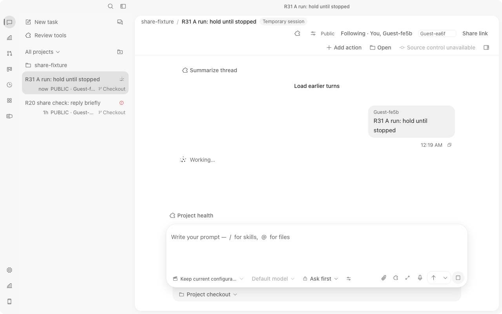
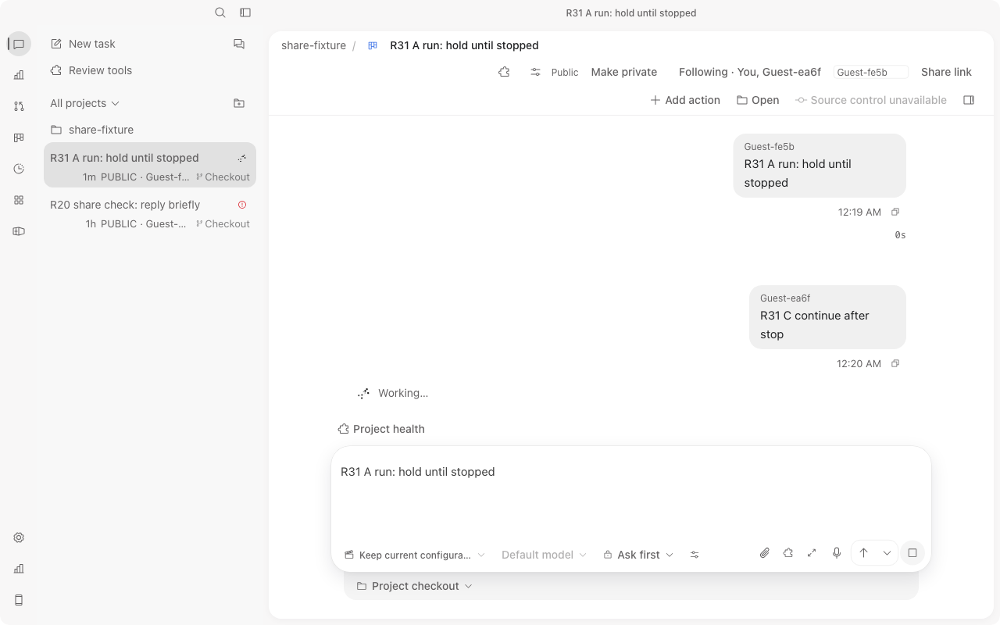
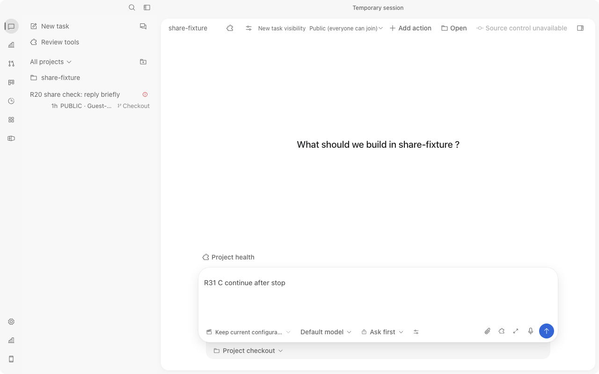
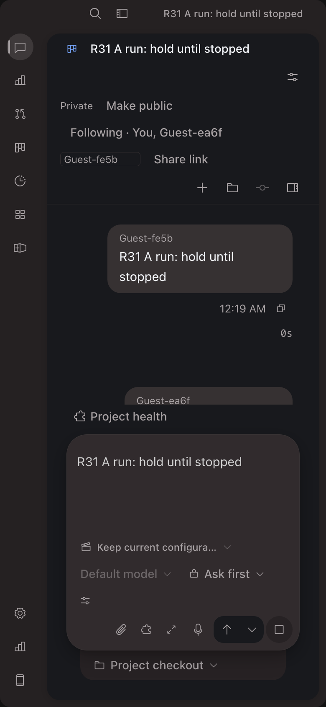

# R31 UI manifest (current bundle, two distinct actors, one Core)

Scope: one uninterrupted real-UI pass against the zero-fee ACP fixture (`share_fixture`, NOT a paid Agent). No DOM/response/event injection, no fake data, no pair URLs or tokens recorded here. No broad feature PASS.

## Provenance

- Main checkout metadata: worktree HEAD `926ebdb5e1a8ec644cf1f8d4efc02d28a8e9c6ef` (dirty work preserved). `/Users/chenli/projects/codeTwo` `f94b88b4c1307013f280c01d0c08f382eaf275f1`, clean.
- Fixture binary (R30-rebuilt, not rebuilt here) sha256 `31d17c4848459b38150f896b08502a557fe0c90707d0f580e3530e8ab434a99d`, port 52943, data `r19/fx-data`, project `r19/proj`, one live Core owner (own pid/pgid 84664).
- Bundle: `vite build --mode web` exit 0, run after the type fix below (outDir `.local/agent-work/20261013-full-share-e2e-r31/dist-web`).
  - HTML-linked JS `assets/percentages-BXMCSKIN-BDHGAfFe.js` 5354774 B sha256 `2e92df948dceb6b2e32e7359d17de0794351dca66587d3388f9403f5a697cf10`
  - HTML-linked CSS `assets/percentages-BXMCSKIN-CMwT83sK.css` 514802 B sha256 `4fa6007116320bba66b834193fed7b1ef509f1bcef26dc5dcec96ddd824216f6`
  - Browser network log shows exactly these two names served (200) to both origins.
- Source (sha256): `session/sessionEvents.ts` `f48ac86f99289fd071db67b8d56d8e8f3f6094de684a5c8b1b226091f05d6cca`, `session/SideChatPanel.tsx` `fe88d3b800fa212bd1f2837259e4ec77e2975d149a79b0622dfa4536dcedda2d`, `session/turns.ts` `20ba462284f79073fae9f519fc3def4a1758aa3c07220bcea0738a490d1d708e`, `App.tsx` `e0df3b4b4d49445100091f12b83591d6e65f2f36f8255e1e7fc7a921c262b1c2`, `bridge.ts` `5fea0dd424fe0201aa9b547b8d9617d023983799cf733f37524972e43159b900`.

## Actors, profiles, viewport

| Actor | Origin | T3 preview profile | Viewport / DPR |
| --- | --- | --- | --- |
| A (creator, `Guest-fe5b`) | `http://127.0.0.1:52943` | incognito | 1280x800 (measured PNG 1280x800), later 390x844 dark (PNG 780x1688, DPR 2) |
| C (`Guest-ea6f`) | `http://localhost:52943` | default | 1280x800 (PNG 1280x800, DPR 1) |

Distinct storage origins and profiles paired through own loopback invitations; actors differ by canonical device nickname in transcript rows. `share.whoami` via `/api/web-ui/call` was NOT run (not done).

## Steps and results

| # | Step | Result |
| --- | --- | --- |
| 1 | New-task UI shows `New task visibility` select, default `Public (everyone can join)`, option `Private (only you)` | PASS (accessibility snapshot, both tabs). Selecting Private was NOT exercised. |
| 1b | A Run via the actual Run button creates a public task; C sees it in rail as `PUBLIC · Guest-fe5b` | PASS |
| 2 | Nonexclusive Follow on both | PASS: C shows `Following · You, Guest-fe5b`; A later shows `Following · You, Guest-ea6f`. Nickname fields visible. Distinct nickname editing NOT exercised. |
| 3a | C opens A's running task: exactly one canonical `Working…` row, author `Guest-fe5b`, no `started elsewhere` | PASS `r31-C-running-one-working-row-1280.png` |
| 3b | C Queue: `QUEUED #1` on C | PASS (A did not show the queued row; same as R24, not changed) |
| 3c | C Stop before the 60 s stub end: A and C no Working row, no Stop button | PASS |
| 3d | After stop, C's `QUEUED #1` row stayed visible on C for the observed period (>20 s), then vanished on the next refresh after continue | NOTED, not root-caused; brief says cancelled queued rows must not stay falsely queued. Open FAIL candidate. |
| 3e | C continue with no Core restart: A shows `Guest-ea6f` author row and Working; C same | PASS `r31-A-continued-C-author-1280.png` |
| 3f | After continue, the earlier A turn changes from `Cancelled 58s` to a bare `0s` | NOTED display regression candidate, not investigated |
| 4 | A `Make private` while C views: C pane returns to new-task, task removed from C rail, toast `This task is no longer shared with…`; A retains private task; other public task stays on C and rail shows mixed PUBLIC/PRIVATE on A | PASS `r31-C-revoked-cleared-1280.png`. C direct read/command refusal appears as two console 400 responses at the revoke instant; no separate server-test replacement. C search preview clear NOT checked. |
| 5 | Narrow 390 dark header: Make public, Following, nickname, Share link, Add action/Open/View all reachable | PASS `r31-A-private-header-390-dark.png` (light390/480/1280 dark NOT done) |
| 6 | After revoke A showed second turn `0s` with Stop button still present while the stub turn still ran | NOTED, not investigated |

## Console (supported preview tool, truthful scope)

A tab: empty. C tab: two `400 Bad Request` resource errors at the revoke instant (refused reads of the now-private task). Not a comprehensive audit.

## Fault found and fixed

`bunx tsc --noEmit` on the R30 baseline failed 5 errors (`sessionEvents.ts` x3, `SideChatPanel.tsx` x2): the bridge `task_snapshot_changed` event now carries `sessions[]`, not `session`. Narrow fix: `shouldRenderSessionEvent` returns false for that event (App.tsx already returns before rendering it) and SideChatPanel skips it before reading `event.session`. Fixed `tsc` exit 0; plan scope amended for these two paths. Runtime behaviour unchanged (the event was already filtered in App.tsx); no new test was written, covered by existing 34-test run.

## Evidence files (sha256, bytes)

- `r31-C-running-one-working-row-1280.png` `bf0922613ec7d7f8be86451036d6f229c65e7535e76e64c039d220cde6ac926d` 80846
- `r31-A-continued-C-author-1280.png` `324ea78b4f1a60ea843d2906f515cfe591d59dd1a4e19c0ee566d3e1f70c24a0` 81423
- `r31-C-revoked-cleared-1280.png` `1c9ffc429de755b00a9c18872fa54f039ff9e590a277c5d5fa35112d1edd21e9` 59284
- `r31-A-private-header-390-dark.png` `07f0690f09c1da80effb4a938807771d17d567944c05c81c21ba9a20bea20662` 107663

## Screenshots

