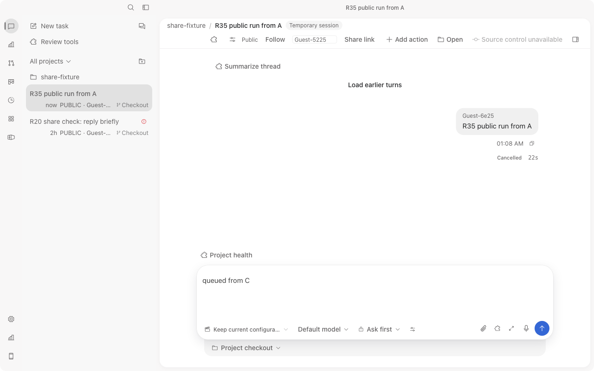
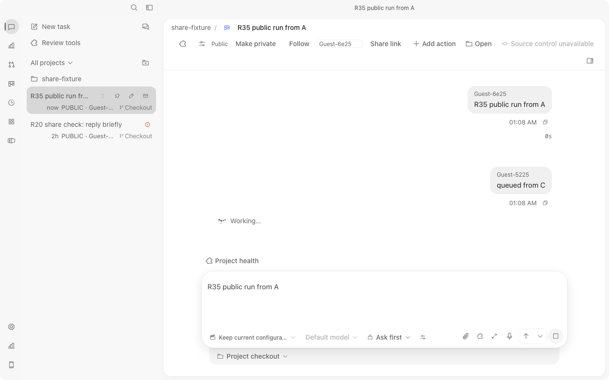
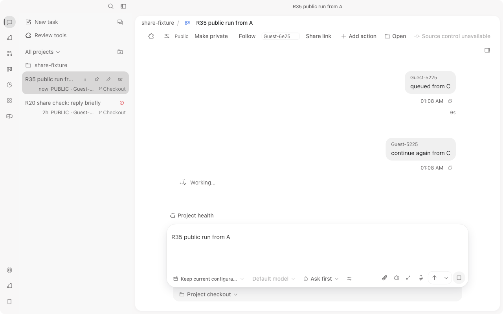
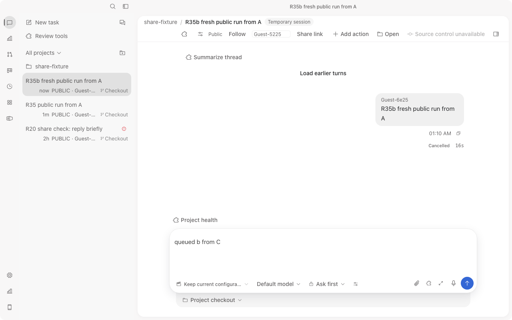
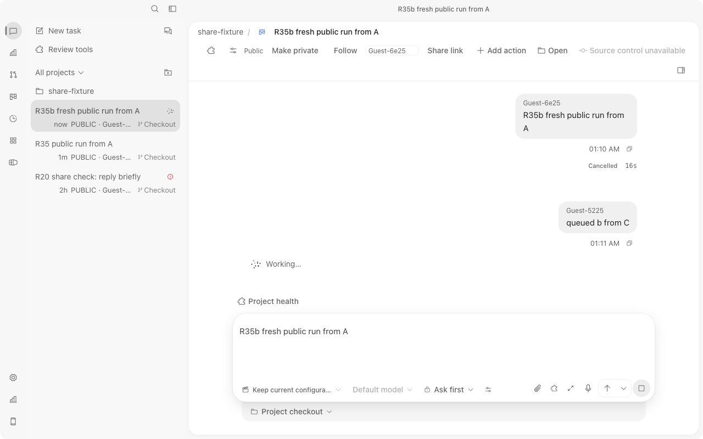

# R35 state manifest

Window 17:04:16Z-17:14:16Z. Worktree 926ebdb5 (dirty by design), brief SHA256 cd809e02...ce7f5d verified.

## Fixes (source sha256)
- apps/desktop/src/session/turns.ts 5e59ead5fba1f87908b4e2bb9fdd397ef729d67b1f8a68dbf120a278de4398fd
  - `turn_started` on an own optimistic row now records `transcript_seq` (was only set for foreign placeholders), so a later transcript read can match it to its known terminal status/time.
  - `mergeLoadedTurns` drops a finished live own turn once its terminal state is folded into the canonical row (otherwise it appeared twice; found by the new test).
- apps/desktop/src/App.tsx 66a4b5647652f43e7a68c637a9c32e2085e1436b5e12d015a00c503054872cef
  - Cause of Cancelled 37s -> 0s: when another actor's turn starts, `selectSession(..., reload=true)` ran `setPaneTurns(pane, [])` before the re-read, erasing every live row (and its Cancelled status/timing). The transcript has no stop reason, so the re-read showed 0s. Now a re-read of the session the pane already shows keeps the live rows and merges.
- R34 scopeEventToSelf request_ids mapping preserved unchanged (share.ts).
- Regression: apps/desktop/tests/sharedTurnReconcile.test.ts c60f197c831c3d64fbfebc5e925d3bf2ef01da09aba3320b435038a06726e273 ("R35" block: own start -> Stop -> next prompt -> reload). Not run against the old code (no time); the dedupe assertion failed on the intermediate code before the merge fix.

## Build / checks (actual exits)
- `bun test tests/sharedTurnReconcile.test.ts tests/share.test.ts tests/sessionState.test.ts tests/transcript.test.ts` exit 0, 83 pass.
- `tsc --noEmit` exit 0 (before and after App.tsx edit).
- `vite build --mode web --outDir r35/dist-web` exit 0 twice (second after App.tsx fix). index.html 1f21fd49d2dcaba8ffd2e2b60d2409c717de6b05b3a113ec6b3b91549edb23a7; JS assets/percentages-BXMCSKIN-QOQyy6hz.js, CSS assets/percentages-BXMCSKIN-CMwT83sK.css.
- Binary: full-sharing/cargo-target/debug/examples/share_fixture 109538416 B sha256 5f85af651f5ae88691d00b3be7fe345361907770ff7f85a2dea074398c85be1f (unchanged, no Rust rebuild).
- `bun script/verify/sdlc.ts --worktree`: FAIL, 1 error: apps/desktop/tests/sessionState.test.ts not covered by an accepted plan scope (pre-existing dirty file, not touched by R35). docs check not run.

## Actual GUI (fixture 127.0.0.1:52943 / localhost:52943, default profile, 1280x800, two agent tabs with reuseExistingTab:false; actors A Guest-6e25 on 127.0.0.1, C Guest-5225 on localhost; console entries: none; whoami not run)
Run 1 used the first bundle (turns.ts fix only) and FAILED the continue check; it is kept as the red evidence. Run 2 used the final bundle.
| run | step | result | PNG |
|---|---|---|---|
| 1 | C queue, Stop at 22s | Cancelled 22s shown, no Queued row | r35-browser-screenshot-localhost-mv6xq5qj-c70368e3.png |
| 1 | C continue, A view | FAIL: 0s, no Cancelled | ...127-0-0-1-mv6xqi0n-20a015da.png, ...127-0-0-1-mv6xqwa3-625ee9a0.png |
| 2 | fresh A public Run, C sees Working, C Queue shows QUEUED #1 (read via DOM text), C Stop at 16s | PASS: both idle, Queued #1 gone, Cancelled 16s | ...localhost-mv6xtich-d8475f69.png |
| 2 | C continue, A live view | PASS: Cancelled 16s kept, C author Guest-5225, ONE Working row | ...127-0-0-1-mv6xtpwb-d7fe4097.png |

PNG sha256: xq5qj 0d1e73b2...; xqi0n e9257453...; xqwa3 007cbee0...; tich aa0e4810...; tpwb 524d1236... (full values: `shasum -a 256 evidence/r35-*.png`; sizes 73581/76016/76087/81153/84974 B).

## Not done
Store-level read-only sqlite corroboration of cancelled queue row, whoami, creator-private/revoke recheck, 390px screenshot, docs check, old-code red run of the new test.

## Removed / Retained / Processes
Removed: fixture pgid 74869 (own, TERM, port 52943 free). Retained: r35 logs, dist-web, run.py, evidence PNGs. Processes: none left.

## Images

