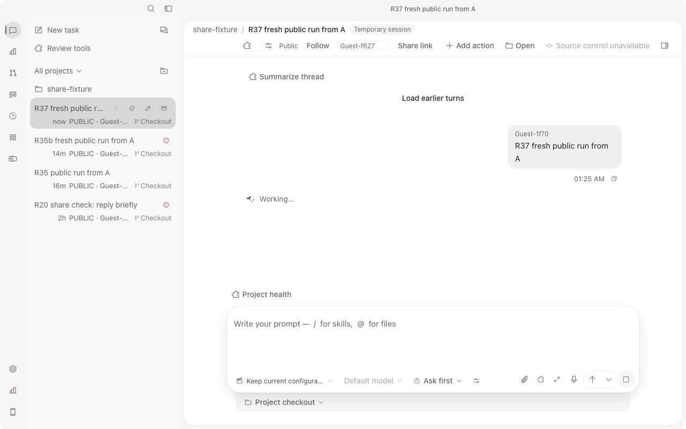
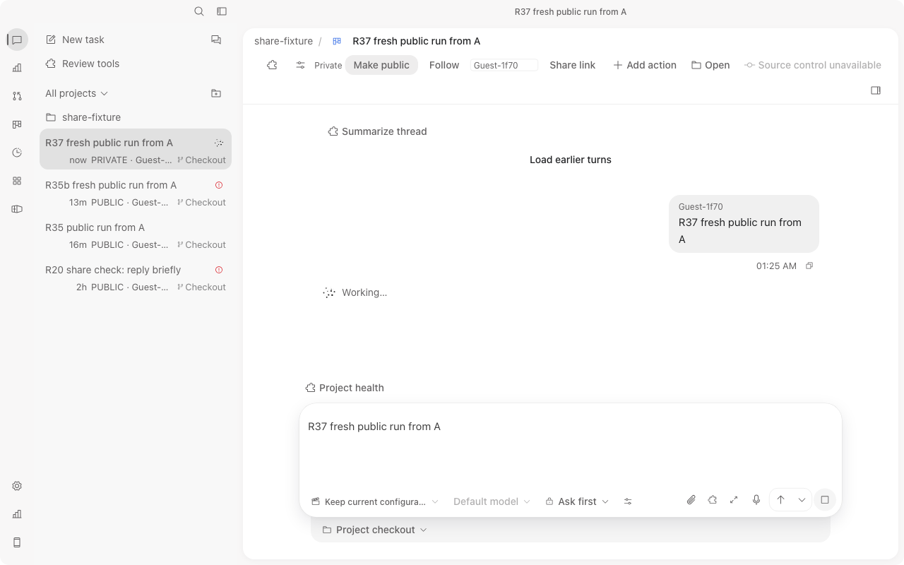
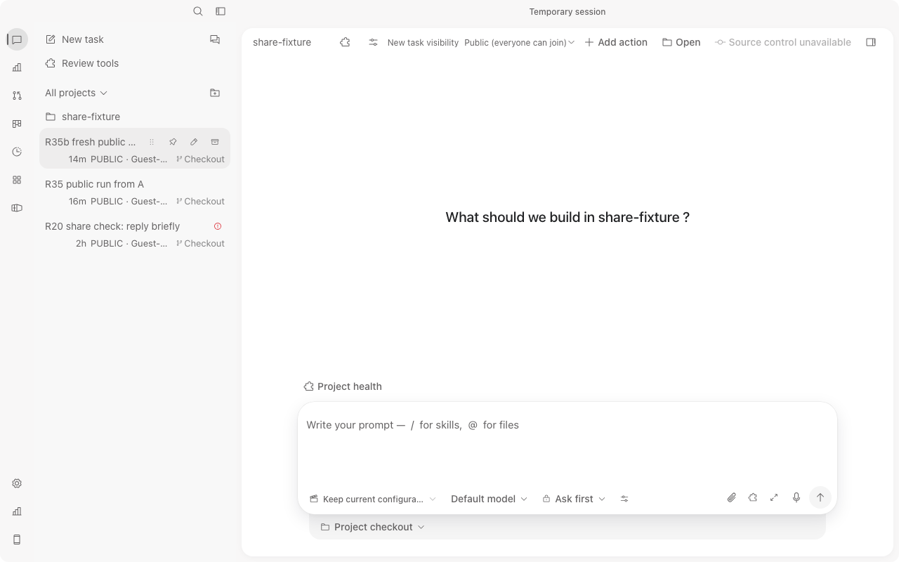
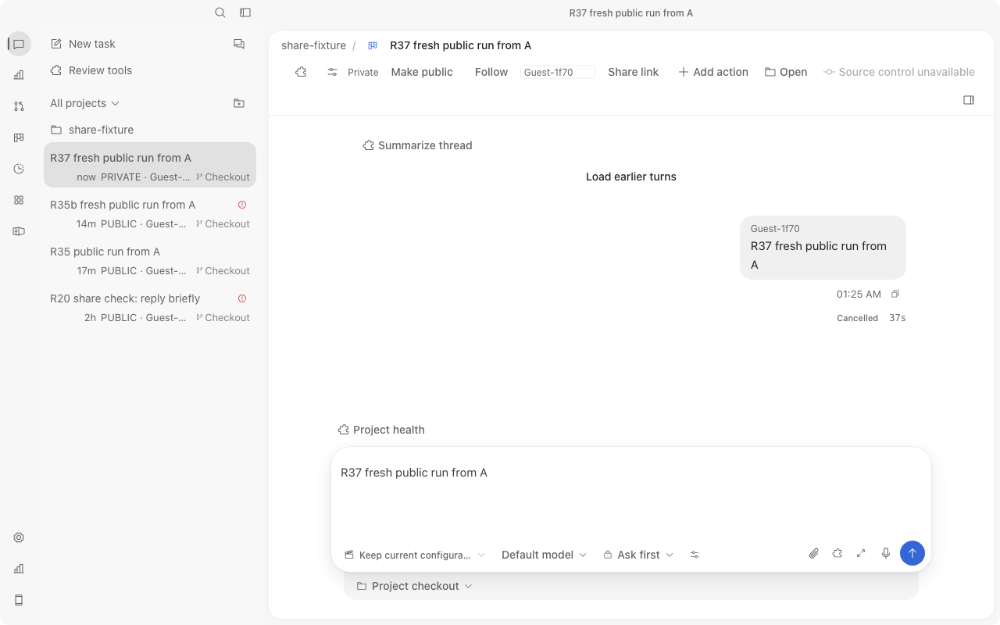
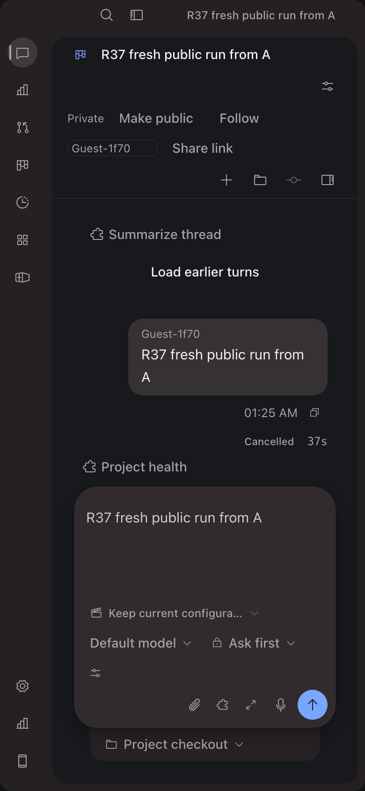

# R37 current-bundle UI evidence (creator-private, 390 px, actors)

Window 2026-10-13T17:22:50Z to 17:32:50Z. Brief SHA256 f56096c52ae33a17a2f08d98fa25a6d0bac63816e02f30a389d3543b7e6427b1 (4265 B) verified. Source read-only; no source, catalog, checker or visualization change.

## Provenance
- Worktree HEAD 926ebdb5e1a8ec644cf1f8d4efc02d28a8e9c6ef, dirty and retained. All 44 `apps/`+`crates/` files listed in the R36 hash table re-hashed identical (none changed since R36). `crates/server/examples/share_fixture.rs` sha256 8c9b81427c94bedfaa532fe5d7201bb331e3335ec171c98cd549e55df9646160.
- Binary `.local/agent-work/20261013-full-sharing/cargo-target/debug/examples/share_fixture` sha256 5f85af651f5ae88691d00b3be7fe345361907770ff7f85a2dea074398c85be1f, 109538416 B, unchanged, not rebuilt.
- Served bundle R36 `dist-web`: `index.html` sha256 1f21fd49d2dcaba8ffd2e2b60d2409c717de6b05b3a113ec6b3b91549edb23a7 (498 B); `assets/percentages-BXMCSKIN-QOQyy6hz.js` 44ddb1cef4771fa18e5f187c9ab03217f0adff8b4717bfc4e45fc63d3189ae94 (5355705 B); `assets/percentages-BXMCSKIN-CMwT83sK.css` 4fa6007116320bba66b834193fed7b1ef509f1bcef26dc5dcec96ddd824216f6 (514802 B). The browser network log loaded exactly these two files.
- Fixture: own process pid/pgid 21151, port 52943, data `r19/fx-data` + `r19/proj`, started 17:23:40Z, READY by 17:24:54Z. Zero-fee python ACP provider `fixture-acp`; no paid Agent.

## Browser
Two own tabs from `preview_open reuseExistingTab:false`, explicit tabId on every call, default profile: A `tab_w_...` at `http://127.0.0.1:52943` and C `tab_x_...` at `http://localhost:52943` (different origins, so different storage and different paired devices). Viewport 1280x800 light at DPR 1 (screenshots 1280x800); A later resized to 390x844 with `prefers-color-scheme: dark`, screenshot 780x1688 (DPR 2). Both used fresh one-time pairing links from the fixture log. Run, Make private and Stop were real clicks; `preview_evaluate` was used only to read DOM/aria labels. No UI, DOM, event or response injection.

## Actors (from the fixture store, no credentials read or printed)
| client | origin | nickname | device id (remote-devices.json) |
|---|---|---|---|
| A (creator) | 127.0.0.1 | Guest-1f70 | `a892063c-261d-475d-b62d-ed91d4e61f70` (created 17:25:00Z) |
| C | localhost | Guest-f627 | `0dc01bcf-a1b6-4e54-8b0c-0ff64999f627` (created 17:25:11Z) |

`session-shares.json` record for the R37 task `4a0760d0-e30b-4928-ac78-e27d19193507`: creator `device:a892063c-261d-475d-b62d-ed91d4e61f70`, visibility `private`, revision 2, followers none, journal `prompt` then `cancel` both by the creator, message author `device:a892063c-...e61f70` nickname Guest-1f70 with request id `device:a892063c-.../3d099ada-b661-4d9e-8e5b-6dd52bbe3cd9`. Device C does not appear in that record. Nicknames map to devices by the id suffix, and C's header showed its own nickname Guest-f627. Literal `share.whoami` was NOT executed (bearer lives in page memory; not searched for). Identity proof is therefore store correlation, partial.

## Result (all on the R36 bundle)
| step | observed | PNG |
|---|---|---|
| fresh public Run by A at 17:25:26Z | C rail shows ONE `R37 fresh public run from A` Working, Public, Guest-1f70; C opened it: transcript shows Guest-1f70 prompt and one `Working…`, header Public/Follow/nickname/Share link | r37-C-sees-working-1280.png |
| A Make private at 17:25:39Z (about 13 s after Run, under 60 s) while C viewing | A: header Private/Make public, rail PRIVATE, still Working with `Stop this turn`. C: pane returned to empty new-task view, R37 row gone from rail, the three other PUBLIC tasks still listed | r37-A-private-working-1280.png, r37-C-revoked-cleared-1280.png |
| A Stop (UI click) at 17:26:04Z | A turn `Cancelled 37s`, no Stop button, header still Private | r37-A-stopped-private-1280.png |
| A 390x844 dark | header wraps to rows: visibility `Private` + `Make public`, `Follow`, nickname field `Guest-1f70`, `Share link`, then action icons; all reachable, no clipping | r37-A-private-header-390-dark.png |

Console: A tab no entries. C tab two `400 Bad Request` resource errors at 17:25:39Z, at the moment the viewed task became private (its reads answer `session not found`); no other entries.

Observations (not fixed, source read-only): the A rail row for the stopped task is labelled `Completed` while the transcript shows `Cancelled 37s`. Not run in R37: C hidden-task read/control refusal by direct HTTP and machine-owner `can_view` (server tests in R36 cover those), a native Core/Electrobun client, and restart. This is evidence for AC-5 only; AC-6 independent review is still pending and no full PASS is claimed.

## Evidence PNGs (sha256, bytes)
- r37-C-sees-working-1280.png 5cc9c1eccef574e9446bc563661e7fce4388365ff22d73c1994cbd92aaa4c73a 89528
- r37-A-private-working-1280.png b0743cf6b4c25904a81c8aa5c45c56985ab35e70804f6ac6d795df4775e3d3f8 88579
- r37-C-revoked-cleared-1280.png 99c226d39037ef8b1b4e358bf30ab173d0c2d58547dd82148530a99e12349367 71570
- r37-A-stopped-private-1280.png c49994aa6c937879e97bb574b3334122b83575d584cebc66c22ba46644881d16 86795
- r37-A-private-header-390-dark.png 7a668f5c218b802b9dba246ba42f0d9adf4a4df2dfa201430f2f3eb83cc3da13 108289

## Record corrections (fact checks)
- Risk `medium` to `high` in intent (carried over from research). No human review or rollout approval recorded.
- Private: creator only; the machine owner is filtered, not automatically included.
- Request ids: another actor with the same client id is independent (`ws_share_parity` asserts "same client id, independent actor namespaces"), not rejected.
- "Known limits (accepted)" renamed to reported limitations (no user waiver). The claim that delivery lookup is not actor-scoped was removed: `share_policy::delivery_lookup_uses_the_callers_actor_namespace` shows it is scoped.
- "two-device" wording now says two isolated browser clients.
- Exact previous four records archived before editing in `.local/agent-work/20261013-full-share-e2e-r37/archive-r37-records/`.
- Earlier R14-R36 reports and PNGs untouched.

## Checks after record changes
- `bun script/verify/sdlc.ts --worktree` exit 1, single error: spec.md high/critical requires independent design approval (see Verification). Expected consequence of the risk correction; not bypassed.
- `bun script/verify/docs.ts` exit 0 ("catalog, links, schemas, and assets valid"); `git diff --check` exit 0. Run directly in the foreground after the last record edit. R36 test/compile results reused unchanged (source hashes identical).

## Removed / Retained / Processes
Removed: own fixture pgid 21151 (TERM at 17:27:09Z; port 52943 free). Retained: R37 logs, archive, evidence PNGs and report, dirty worktree 926ebdb5, main `/Users/chenli/projects/codeTwo` branch `refactor/architecture-simplification` HEAD f94b88b4c1307013f280c01d0c08f382eaf275f1 clean. Processes left: none.
