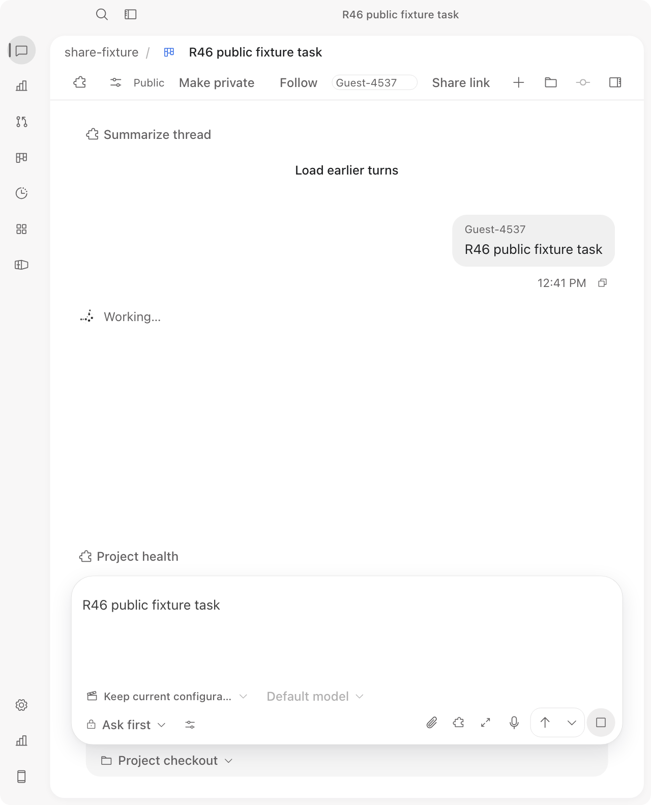
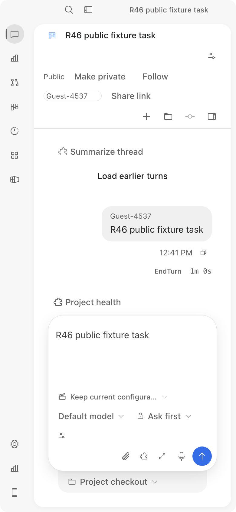
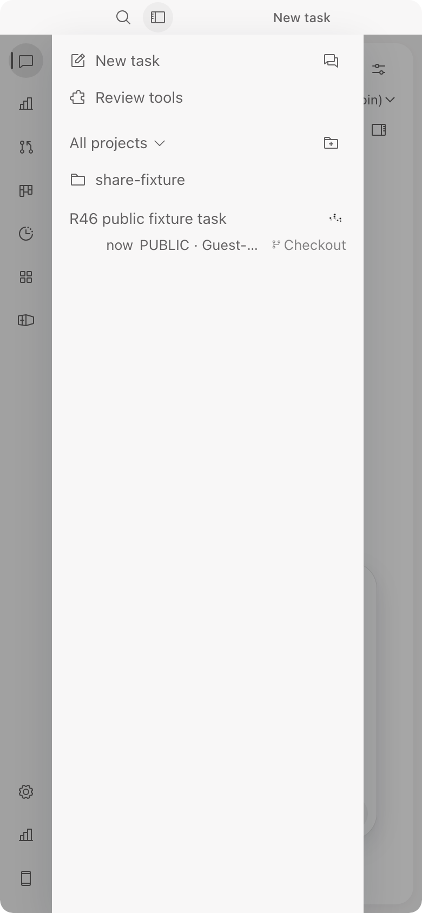
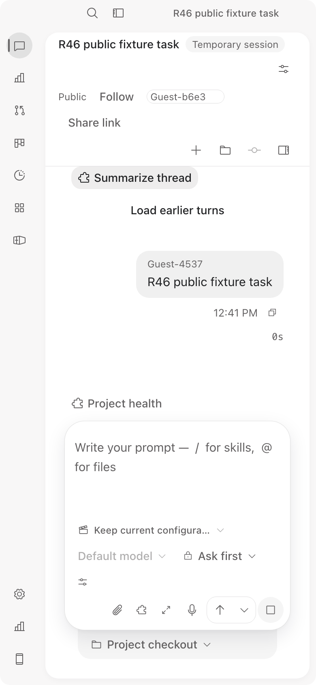
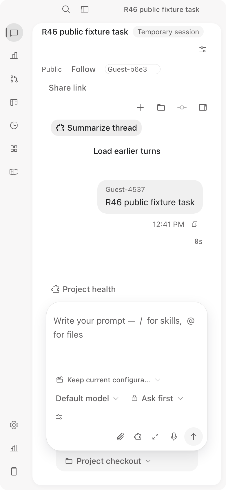

# R46 lint-delta review and current rendered UI

Independent fresh-context Agent review of head `d3dfe28abbb074bbc85249e25bb89b21350e1ebc` (delta `4a554bf3..d3dfe28`,
9 files, +196/-71). It is Agent verification, not human review. The raw R46 report is kept unchanged in the ignored
private task directory: `result.md` SHA256 3a05ed6dee0ccb69cbd190b98abb58aca24ddb5eb892864c23ffa388738fb689,
`review.json` SHA256 3f8e48de01df2f482e4a476e8ac7ea7b1f0ae0fae0628129a3fd38919b8c269f. The corrections below come
from the parent's acceptance and take precedence over the raw wording.

## Reviewed
No blocking finding and no regression in the lint delta (request-id scoping, async wrappers, null and empty-string checks,
the new-task visibility select, the `rounded-control` class, `turns.ts` parameter renames and the no-op
`session_share_changed` case). A fresh `vite build --mode web` and the offline `share_fixture` build exit 0.

## Rendered UI
The same Mac, one fixture Core, two browser origins (`127.0.0.1` and `localhost`) with two anonymous credential
identities. These are **not two physical devices** and not cloud or remote acceptance. The fixture agent has no native
Steer, so no steer control was expected. Screenshots (not a policy proof; hidden UI proves nothing about the server):

- A at 728 px, working, with Public, Make private, Follow, nickname, Share link, author badge and Stop/Queue:
  
- A at 390 px after the turn ended:
  
- B at 390 px, rail showing the public task with a working spinner:
  
- B at 390 px after opening the shared task, Stop visible while the turn ran:
  
- B at 390 px after the turn ended, Stop gone:
  

| File | Bytes | SHA256 |
|---|---|---|
| r46-A-390-endturn.png | 103348 | 69fe6e0050f53bfea17eb42270a62d191d970785eafbeceb60419eed70038a1d |
| r46-A-728-working.png | 103978 | a00f5e2362296fefeafd12ced5a6804158b4e49904dc1c090030fbce06cb1dbc |
| r46-B-390-final.png | 107828 | 664111abeda105651a3572dd59410a5ba38493bab982683c032378e40c57b1e2 |
| r46-B-390-rail.png | 55218 | 757eb71ec3f508bea13cc051d7fe4d371550af99de9df2bfe3d562b3d2bf5377 |
| r46-B-390-shared-task.png | 109336 | e2be06a75b3ea14fc84bd915e9c19c97456183fdb7f592a69a8185854e999633 |

## Open observations (unresolved)
- B opened the task after it started and showed `0s` with Stop but no Working row; after the end it still showed `0s`
  while A showed `EndTurn 1m 0s`.
- A's composer kept the sent draft text after Run.

Neither was compared against the previous bundle, so whether they predate `d3dfe28` is **not known**.

## Not run
Make private flip, Stop through the UI, a message sent from B, a backend private-filter test, native Steer, paid
Agent, cloud or physical remote use. Server policy proof is still the R36 and R41 focused tests, unchanged. Fixture
port 52961 (process 38006) was stopped and released.
